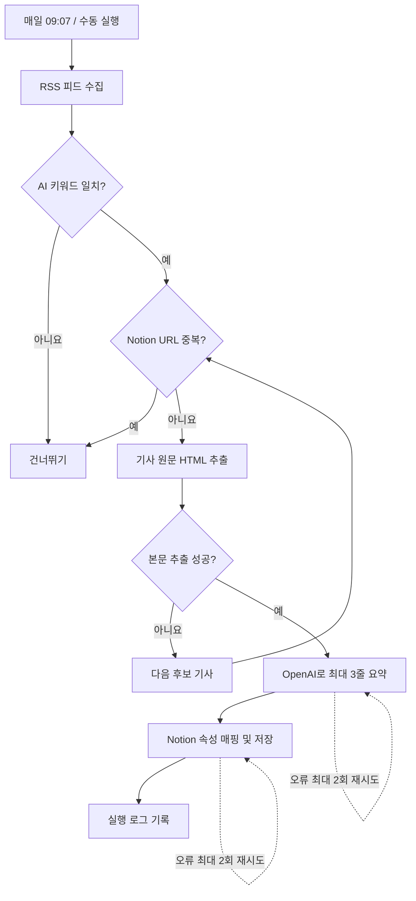

# 자동화 흐름 및 설계 근거

- 트리거: GitHub Actions schedule / workflow_dispatch
- 수집: RSS 주소 한 개 이상 (RSS 피드 없는 사이트 스크래핑 금지)
- 사전 필터: AI, OpenAI, ChatGPT, LLM 등. 범위를 좁혀 관련 없는 기사 요약 비용을 방지.
- 중복 방지: Notion '원문 링크' URL과 동일한 항목이 있는지 저장 전에 검사.
- AI: 기사 본문으로부터 한 기사당 1번 호출, 실패 시 최대 2번 재시도.
- 저장: 제목(title), 요약(rich_text), 원문 링크(url), 발행일시(date).
- 실패 처리: RSS 오류는 해당 피드 건너뛰기; 본문 추출 실패 시 다음 후보. Notion 저장 실패는 종료하여 중복 요약 비용 방지.
- 기사 없을 때: 완료(신규 저장 0건)로 종료.
- 기술: Python, feedparser, trafilatura, OpenAI Responses API, Notion API, GitHub Actions.

**주의:** GitHub Actions는 정시 실행을 보장하지 않으므로 스케줄 실행의 로그를 확인한다. URL이 다르더라도 같은 기사를 가리키는 별칭 링크는 완벽하게 잡히지 않을 수 있다.
